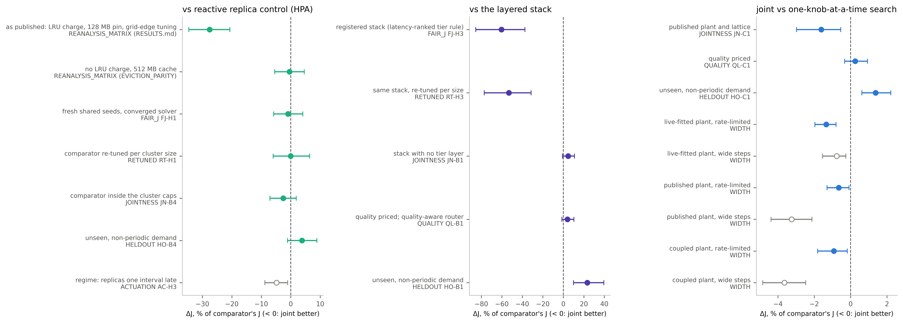

# fig22 — how the advantage vanished (figure sheet)

Generated by `fig_adjudication_chain.py` from the committed exports, through each campaign's frozen scorer; this sheet is the caption and every plotted number. Not a record: it adds no reading.

**Caption.** How the joint controller's advantage vanished under registered adjudication. Each row is treatment − comparator on J at the design-point unit, as a share of the comparator's J, with the 95% bootstrap CI (10,000 resamples, seed 20260926), computed from the committed export through the scorer that judged it (J_q, priced with answer quality, in the QUALITY rows); hollow rows are regimes, not steps. A (against HPA): -27.5% as first published; once the audited comparator defects are removed every later step's CI spans 0, ending at +3.8% on unseen demand. With replicas one interval late: -4.8% (joint better). B (against the layered stack): -60.4% against the registered stack and its latency-ranked tier rule; with the tier pinned to the cheapest model instead, +4.7% (CI spans 0) on the published matrix and +23.3% (comparator better) on unseen demand. C (coordination itself): -1.6% (joint better) on the published plant and +1.4% (comparator better) on unseen demand, inside the registered ±0.025 J equivalence margin both times. It grows only with wide steps where the layers share capacity (WIDTH), and wide steps raise the joint controller's own J on every plant (WD-H5).

| track | step | source | treatment | comparator | design points | ΔJ | ΔJ % | 95% CI % |
|---|---|---|---|---|---:|---:|---:|---|
| A | as published: LRU charge, 128 MB pin, grid-edge tuning | REANALYSIS_MATRIX (RESULTS.md) | `jcac` | `hpa` | 60 | -0.1529 | -27.5% | [-34.6%, -20.7%] |
| A | no LRU charge, 512 MB cache | REANALYSIS_MATRIX (EVICTION_PARITY) | `jcac` | `hpa_fair` | 60 | -0.0018 | -0.4% | [-5.4%, +4.6%] |
| A | fresh shared seeds, converged solver | FAIR_J FJ-H1 | `jcac_converged` | `hpa_fair` | 60 | -0.0037 | -0.9% | [-5.8%, +4.1%] |
| A | comparator re-tuned per cluster size | RETUNED RT-H1 | `jcac_converged` | `hpa_fair_retuned` | 60 | -0.0001 | -0.0% | [-6.0%, +6.4%] |
| A | comparator inside the cluster caps | JOINTNESS JN-B4 | `jcac_converged` | `hpa_fair_capped` | 60 | -0.0104 | -2.5% | [-7.1%, +1.9%] |
| A | unseen, non-periodic demand | HELDOUT HO-B4 | `jcac_converged` | `hpa_fair_capped` | 24 | +0.0122 | +3.8% | [-1.1%, +8.9%] |
| A | regime: replicas one interval late | ACTUATION AC-H3 | `jcac_converged` | `hpa_fair_capped` | 60 | -0.0204 | -4.8% | [-8.8%, -1.1%] |
| B | registered stack (latency-ranked tier rule) | FAIR_J FJ-H3 | `jcac_converged` | `jcac_nojoint_v2_tuned` | 60 | -0.6109 | -60.4% | [-85.5%, -37.5%] |
| B | same stack, re-tuned per size | RETUNED RT-H3 | `jcac_converged` | `jcac_nojoint_v2_retuned` | 60 | -0.4542 | -53.1% | [-77.2%, -31.5%] |
| B | stack with no tier layer | JOINTNESS JN-B1 | `jcac_converged` | `layered_small_tuned` | 60 | +0.0178 | +4.7% | [-0.8%, +10.9%] |
| B | quality priced; quality-aware router | QUALITY QL-B1 | `jcac_quality` | `layered_quality_capped` | 60 | +0.0179 | +4.0% | [-1.4%, +10.3%] |
| B | unseen, non-periodic demand | HELDOUT HO-B1 | `jcac_converged` | `layered_small_tuned` | 24 | +0.0629 | +23.3% | [+10.0%, +39.5%] |
| C | published plant and lattice | JOINTNESS JN-C1 | `jcac_converged` | `jcac_decoupled` | 60 | -0.0066 | -1.6% | [-3.0%, -0.5%] |
| C | quality priced | QUALITY QL-C1 | `jcac_quality` | `jcac_quality_decoupled` | 60 | +0.0012 | +0.3% | [-0.3%, +0.9%] |
| C | unseen, non-periodic demand | HELDOUT HO-C1 | `jcac_converged` | `jcac_decoupled` | 24 | +0.0045 | +1.4% | [+0.6%, +2.2%] |
| C | live-fitted plant, rate-limited | WIDTH | `jcac_joint_tracked` | `jcac_decoupled` | 48 | -0.0033 | -1.3% | [-2.0%, -0.8%] |
| C | live-fitted plant, wide steps | WIDTH | `jcac_joint_wide_tracked` | `jcac_decoupled_wide` | 48 | -0.0021 | -0.8% | [-1.5%, -0.3%] |
| C | published plant, rate-limited | WIDTH | `jcac_joint_tracked` | `jcac_decoupled` | 48 | -0.0044 | -0.7% | [-1.3%, -0.1%] |
| C | published plant, wide steps | WIDTH | `jcac_joint_wide_tracked` | `jcac_decoupled_wide` | 48 | -0.0231 | -3.2% | [-4.4%, -2.1%] |
| C | coupled plant, rate-limited | WIDTH | `jcac_joint_tracked` | `jcac_decoupled` | 48 | -0.0092 | -0.9% | [-1.8%, -0.2%] |
| C | coupled plant, wide steps | WIDTH | `jcac_joint_wide_tracked` | `jcac_decoupled_wide` | 48 | -0.0407 | -3.6% | [-4.8%, -2.5%] |

