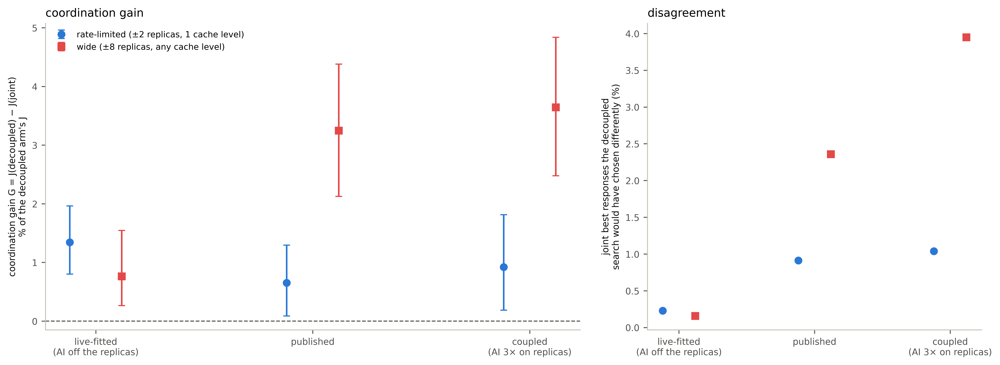

# fig23 — coordination vs actuation width (figure sheet)

Generated by `fig_width.py` from the same inputs and functions as `RESULTS_WIDTH.md` (`analysis_width.py`); this sheet is the caption and every plotted number. Not a record: it adds no reading.

**Caption.** Coordination between one tenant's knobs grows with how far one interval may move, and only where the layers share capacity (PREREG_WIDTH, 48 AI-carrying design points × 5 reps per plant). Left: the gain G of the joint search over the decoupled one, as a share of the decoupled arm's J, with the 95% bootstrap CI, on the published rate-limited lattice (±2 replicas, one cache level per interval) and on a wide one (±8 replicas, any cache level). Rate-limited: +1.3% / +0.7% / +0.9%; wide: +0.8% / +3.2% / +3.6% (live-fitted / published / coupled plant). Right: the share of the joint search's best responses the decoupled search would have chosen differently — at most 1.04% on the rate-limited lattice, as local separability predicts, and at most 0.23% at either width on the live-fitted plant, where AI work never loads the replicas. Wide steps raise the joint arm's own J on every plant (WD-H5, J rate-limited − J wide: -0.030 / -0.015 / -0.086).

| plant | lattice | design points | G (J) | G % of decoupled J | 95% CI % | disagreement |
|---|---|---:|---:|---:|---|---:|
| live | narrow | 48 | +0.0033 | +1.34% | [+0.80%, +1.96%] | 0.23% |
| live | wide | 48 | +0.0021 | +0.76% | [+0.26%, +1.55%] | 0.16% |
| published | narrow | 48 | +0.0044 | +0.65% | [+0.09%, +1.30%] | 0.91% |
| published | wide | 48 | +0.0231 | +3.25% | [+2.13%, +4.38%] | 2.36% |
| coupled | narrow | 48 | +0.0092 | +0.92% | [+0.19%, +1.81%] | 1.04% |
| coupled | wide | 48 | +0.0407 | +3.64% | [+2.48%, +4.84%] | 3.95% |

WD-H5, the joint arm's own J on the rate-limited lattice minus on the wide one (negative = rate-limited better):

| plant | J rate-limited − J wide |
|---|---:|
| live | -0.0301 |
| published | -0.0152 |
| coupled | -0.0859 |

